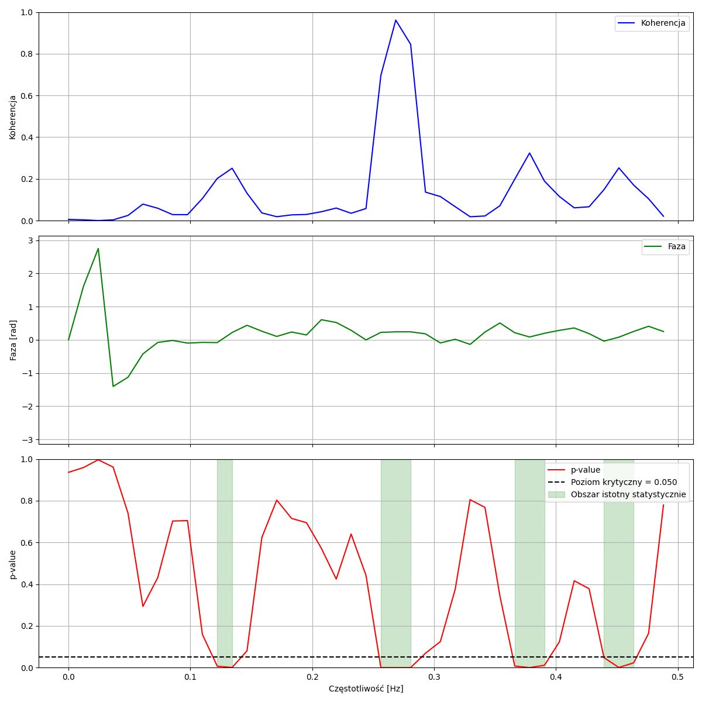

# Coherence Analysis of Intracranial and Arterial Blood Pressure Signals

A Python tool for analysing the relationship between **intracranial pressure (ICP)** and **arterial blood pressure (ABP)** signals in the frequency domain. It calculates the spectra of both signals, the energy in physiological frequency bands and the **coherence** between them, together with a test of statistical significance.

## Features

- **Loading and cleaning data**: reads ICP and ABP signals from CSV files, replaces missing values (NaN) and calculates the sampling frequency from timestamps (including recordings spanning several days).
- **Signal plots**: ICP and ABP in a chosen time window.
- **Spectral analysis (FFT)**: spectra of both signals on a linear or dB scale, with frequency bands highlighted.
- **Band energy**: energy of each signal in three bands:
  - VLF: 0.02–0.07 Hz
  - LF: 0.07–0.2 Hz
  - HF: 0.2–0.5 Hz
- **Coherence analysis**: magnitude-squared coherence and phase between ICP and ABP (Welch's method, `scipy.signal.coherence` and `scipy.signal.csd`), p-values for each frequency and the ranges where coherence is statistically significant (p < 0.05).
- **Band summary**: mean and maximum coherence, mean phase and phase at maximum coherence for each band.

## Example results

Coherence, phase and significance for patient PAC7:



Results for five patients (PAC7, PAC10, PAC11, PAC22, PAC45) are in the [`resoults/`](./resoults) folder. Each patient folder contains:

| File | Content |
|---|---|
| `00.png` | First 10 seconds of the ICP and ABP signals |
| `01.png`, `02.png` | Spectra of both signals (dB and linear scale) with frequency bands |
| `03.png` | Coherence, phase and p-values |
| `notes.txt` | Signal parameters, band energy and coherence summary |

## Getting started

### Requirements

```sh
pip install numpy pandas scipy matplotlib
```

### Input data

Put the CSV files in a `data/` folder in the directory you run the script from. Each file should contain the columns:

- `DateTime`: timestamp
- `icp[mmHg]`: intracranial pressure
- `abp[mmHg]`: arterial blood pressure

The recordings are not included in the repository because they are medical data.

### Run

Set the file name in `main()` in `src/analyse.py`, then run:

```sh
python src/analyse.py
```

The script shows the plots and prints the band energy and coherence summary to the console.

## Code structure

`src/analyse.py` contains three classes:

- `SignalData`: stores a single signal with its sampling frequency and start time
- `SignalLoader`: loads and cleans the data from CSV files
- `SignalAnalyzer`: spectral, band energy and coherence analysis with plots

## Author

Natalia Kowal
